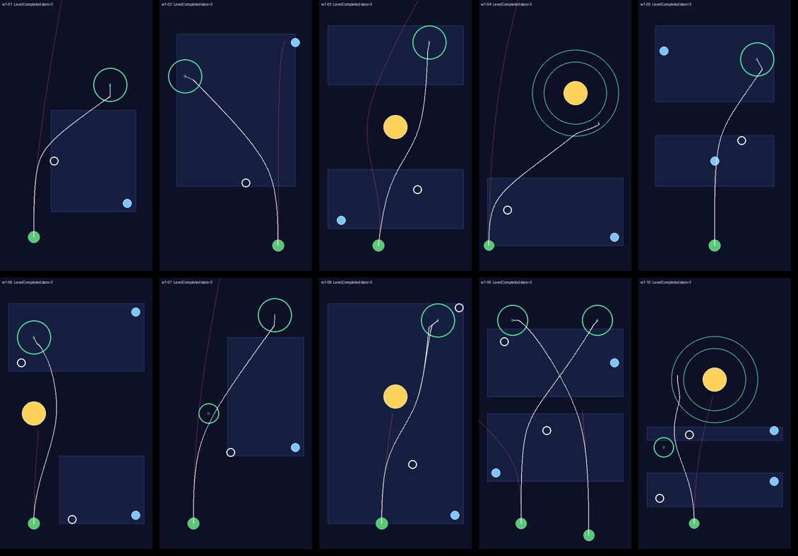

# World 1 "First Light" levels (vertical slice)

Generated from `Assets/Game/Data/Resources/Levels/*.json`. Every solution below is replayed by the automated
tests (`LevelDataTests`) and by `Tools/check-all.sh`; each level is also checked to fail when launched
without any move. Difficulty is 1 (gentle) to 5 (expert). Star columns are the move counts for two / three
stars (three stars also require no hint). One star is always "complete the level".

| Level | Name | Diff. | Teaches | 2★ / 3★ moves | Verified solution | Rules |
|---|---|---|---|---|---|---|
| 1-1 | First Pull | 1 | Gravity bends a planet's path. Drag the beacon, watch the preview, launch. | 2 / 1 | b1 → (-1.3, -1.5) | – |
| 1-2 | Hard Turn | 1 | The closer the beacon, the harder it pulls and the sharper the turn. | 2 / 1 | b1 → (0.6, -2.8) | – |
| 1-3 | Mind the Sun | 2 | Stars pull too, but they cannot be moved, and touching one destroys the planet. | 2 / 1 | b1 → (1.3, -3.2) | – |
| 1-4 | Into Orbit | 2 | Orbit rings catch a planet that slides in alongside them, not one that crashes straight through. | 2 / 1 | b1 → (-2.8, -4.4) | – |
| 1-5 | One Shot | 2 | Move limits: only one move is allowed, so choose which beacon to move. | 1 / 1 | b1 → (1.6, -0.3) | move limit 1 |
| 1-6 | Two Hands | 3 | Two beacons can work together: one bends the path out, the other bends it back. | 3 / 2 | b1 → (-0.25, -6.25); b2 → (-3.25, 3) | – |
| 1-7 | Waypoint | 3 | Sequential objectives: touch the numbered waypoint first, then dock. | 2 / 1 | b1 → (-0.3, -2.3) | – |
| 1-8 | Mid-Course | 3 | Turn-based flight: the planet pauses every few seconds so the beacon can be moved again mid-flight. | 3 / 2 | b1 → (1, -3); b1 → (3.75, 6.25) (launch between moves) | turn-based (2.5 s legs) |
| 1-9 | Twin Pebbles | 4 | Two planets, each with its own dock. Every beacon pulls both planets, and they must not collide. | 3 / 2 | b1 → (-0.5, -1); b2 → (-3, 4.25) | – |
| 1-10 | Grand Tour | 4 | Combines waypoints, orbit rings and a limited-use beacon (it can only be moved once). | 3 / 2 | b1 → (-3.25, -5); b2 → (-1.5, -1.25) | move limit 3 |

Solution-space difficulty (share of grid positions that solve the level in the stored number of moves, from
`LevelLab solve`): 1-1 ≈ 11%, 1-2 ≈ 3%, 1-3 ≈ 4%, 1-4 ≈ 16%, 1-5 ≈ 21% (with the right beacon),
1-6 ≈ 1.8% of beacon pairs, 1-7 ≈ 5%, 1-8: two-leg solutions plentiful once the first leg is right,
1-9 ≈ 0.7% of pairs, 1-10 ≈ 0.5% of pairs. Lower numbers mean more precise placement; the trajectory
preview is what makes the later levels fair.

Red line: path if the player launches without moving anything. White line: stored solution. White
circles: solution beacon positions. Blue rectangles: legal placement regions.
